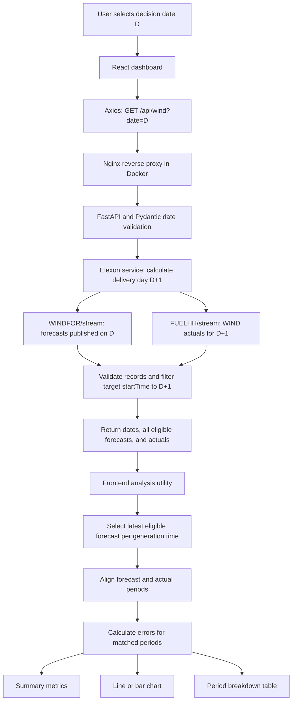

# WindScope

React + TypeScript frontend and FastAPI + Pydantic backend for comparing Elexon
wind generation forecasts and actuals. AI tools (OpenAI Codex) assisted with implementation.

## AI use

I used OpenAI Codex extensively for this assessment. I worked through the
requirements, learned how the Elexon forecast and actual-generation APIs work,
and planned the application flow and architecture with AI assistance. I then
used Codex to generate most of the implementation, including the backend,
frontend, Docker configuration, and documentation.

I reviewed the generated code and results before moving forward, checking that
they matched the intended flow and my understanding of the requirements. To be
transparent, I did not manually write much of the code for this assessment.
My contribution focused on understanding the problem, directing the implementation,
reviewing the code, and taking the application through deployment.

The assessment took me less than four hours to complete and deploy.

## Understanding the requirement

The intended user is an electricity buyer who needs to understand next-day wind
generation before deciding how much additional electricity to procure. WindScope
supports that decision by showing Elexon's wind forecast and measuring how closely
it matched actual generation afterward.

The brief led to two product responsibilities:

1. Show wind generation forecasts relevant to a day-ahead purchase decision.
2. Quantify the difference between forecasts and actual generation.

Elexon supplies both datasets, so the product retrieves and evaluates existing
forecasts. It does not train a prediction model or predict weather. Demand,
electricity prices, other generation sources, and purchase execution are outside
this version's scope. Without demand data, the dashboard cannot calculate the
utility's complete purchase requirement.

The assessment specifies **purchase decisions made in January 2026**. We interpret
the selected date as decision day **D**, and the following date as delivery day
**D+1**. For example, selecting 1 January means reviewing forecasts for 2 January.
A decision on 31 January maps to delivery on 1 February. The default selection
is 1 January 2026. Today and future dates are also selectable as an extension
requested during development; this does not change the assessment's January focus.

### Design decisions and rationale

| Decision | Why we chose it |
| --- | --- |
| A single decision-date input | The following delivery day can be calculated automatically, reducing ambiguity between publication dates and generation dates. |
| React + TypeScript and FastAPI + Pydantic | React and Python follow the brief; TypeScript describes the frontend data contract, and Pydantic validates input and upstream records. |
| A dedicated backend Elexon service | Keeps external API calls, parameters, filtering, and upstream failure handling out of route and presentation code. |
| Concurrent forecast and actual requests | The two requests are independent; fetching them together avoids serial waiting. |
| Preserve forecast revisions in the backend response | Keeps publication history available and separates retrieval from the frontend's current revision-selection policy. |
| Separate analysis utilities and chart components | Error calculations can be tested independently; line and bar views reuse the same processed data. |
| Both summary cards and a period table | Cards show overall accuracy; the table exposes individual values and the reason for each error. |
| Explicit missing-data states | Missing generation is different from zero; future actuals must not produce artificial accuracy scores. |
| Separate frontend/backend containers | Keeps runtime responsibilities clear and supports independent builds. Compose provides one-command local startup. |
| Nginx forwarding `/api` to FastAPI | The browser uses one origin in Docker, and the existing Axios `/api` base URL continues to work. |

### Implementation plan

The work was organized around the following dependencies:

1. **Understand the data:** distinguish forecast publication time from target
   generation time and inspect both Elexon responses.
2. **Define the API contract:** accept one validated decision date and return
   `decision_date`, `delivery_date`, `forecasts`, and `actuals`.
3. **Implement retrieval:** call both upstream APIs, validate their responses,
   retain the delivery day's relevant records, and report upstream failures.
4. **Build the comparison:** select eligible forecast revisions, align time
   periods, preserve missing values, and calculate errors.
5. **Build the dashboard:** date selection, automatic fetching, summary cards,
   independent line/bar components, and a detailed table.
6. **Package and verify:** add Docker builds and the Nginx proxy, then verify
   service readiness and real API requests through the complete stack.

## Application flow



In native development, Vite provides the `/api` proxy in place of Nginx. In Docker,
Nginx serves the already-built React files and proxies API requests. The browser
never calls the Elexon endpoints directly.

## How we use the Elexon APIs

Base URL: `https://data.elexon.co.uk/bmrs/api/v1`

Both calls are HTTP GET requests made by `backend/services/elexon.py`, using a
shared asynchronous HTTPX client with an `Accept: application/json` header.
`asyncio.gather` runs the two calls concurrently. The `/stream` endpoints return
JSON arrays; the application fetches each response as a complete payload, rather
than maintaining a live event subscription.

### 1. WINDFOR: retrieve forecast revisions

[Official WINDFOR documentation](https://bmrs.elexon.co.uk/api-documentation/endpoint/datasets/WINDFOR/stream)

For decision date **1 January 2026**, the backend requests:

```text
GET /datasets/WINDFOR/stream
publishDateTimeFrom = 2026-01-01T00:00:00+00:00
publishDateTimeTo   = 2026-01-01T23:59:59+00:00
```

These parameters filter **when a forecast was published**, not when the predicted
power will be generated. The actual service uses these exact second-resolution
bounds; it then rechecks that publication timestamps fall within the selected UTC
day. Publications in the final fractional second after 23:59:59 would fall outside
the upstream query window.

| Response field | How we use it |
| --- | --- |
| `publishTime` | Identifies a forecast revision and determines which eligible revision is latest. |
| `startTime` | Identifies the generation time being predicted; filters forecasts to delivery day D+1. |
| `generation` | Supplies the predicted wind power value in MW. |

One publication can include targets on several dates. Several publications can
also predict the same target time. Therefore the backend filters targets to
`2026-01-02T00:00:00Z <= startTime < 2026-01-03T00:00:00Z` and returns all retained
revisions, sorted by target time and publication time. The frontend groups them
by target time and selects the latest publication issued on decision day D.

**Current assumption:** the comparison uses the latest publication anywhere in
the full decision day. The brief does not specify a purchase cutoff time. This is
an end-of-day historical view; it must not be described as a forecast available
before an earlier market purchase cutoff. A true as-of view would need an explicit
cutoff and, where needed, earlier publication dates to find the latest eligible
forecast. Today uses publications available so far; future decision dates normally
have no publications yet.

### 2. FUELHH: retrieve actual wind generation

[Official FUELHH documentation](https://bmrs.elexon.co.uk/api-documentation/endpoint/datasets/FUELHH/stream)

For the same decision date, actuals are requested for **2 January 2026**:

```text
GET /datasets/FUELHH/stream
settlementDateFrom = 2026-01-02
settlementDateTo   = 2026-01-02
fuelType          = WIND
```

Settlement-date parameters accept **date-only strings**, not datetimes. Both
bounds are set to the delivery date to retrieve that day. We omit
`settlementPeriod` so all periods are returned. We also omit publication-date
filters: Elexon does not allow settlement-date and publication-date filters to be
combined on this endpoint.

| Response field | How we use it |
| --- | --- |
| `settlementDate` | Identifies the generation date. |
| `settlementPeriod` | Identifies the half-hour settlement period. |
| `startTime` | Aligns actual generation with the target generation time. |
| `publishTime` | Identifies when the result was published; the frontend uses it to deduplicate actual revisions. |
| `fuelType` | Must be `WIND`; other fuels are excluded. |
| `generation` | Average wind power in MW over the half-hour interval. |

For 2 January, a complete response contains 48 half-hour periods. The last one
starts at 23:30 on 2 January and can be published at 00:00 on 3 January. It still
belongs to 2 January. We match by generation time, not publication time, and sort
records before charting. Missing periods are not invented.

### Backend response and failure handling

The application exposes:

```text
GET /api/wind?date=2026-01-01
```

Its response has this shape (arrays abbreviated for illustration):

```json
{
  "decision_date": "2026-01-01",
  "delivery_date": "2026-01-02",
  "forecasts": [],
  "actuals": []
}
```

The arrays contain the validated records described above. Empty arrays represent
no available records and are returned without fabricated values.

- Invalid input, datetimes instead of dates, and extra query parameters return
  **422**.
- HTTPX has a **10-second connection timeout** and **60-second request phase
  timeout**; upstream timeouts return **504**.
- Upstream HTTP errors, connectivity failures, and malformed upstream responses
  return **502**.
- The current endpoint returns an error if either upstream request fails; it does
  not return a partial-success response.
- There is no database, cache, background polling, or automatic retry. A date
  change or manual Refresh triggers new requests. The frontend cancels obsolete
  browser requests and prevents their responses from replacing the selected day.

## Aligning generation and measuring forecast error

Our inspected sample contains hourly forecast targets and half-hourly actuals.
The analysis is implemented in `frontend/src/utils/analyzeWind.ts`:

1. Select the latest eligible forecast revision for each target timestamp.
2. Select the latest actual revision for each timestamp.
3. If all retained forecast targets fall on full UTC hours, use an hourly
   comparison. Average the actual readings at HH:00 and HH:30; require both.
4. Otherwise, use actual values at their original timestamps and compare exact
   timestamp matches.
5. Build chart/table points in time order. Only calculate an error when both
   forecast and actual values exist.

Hourly averaging is a documented comparison choice based on the sample's
resolution, not a claim that Elexon guarantees every forecast represents an
hourly-average value. That semantic assumption should be confirmed before treating
the analysis as an operational trading assessment. The current full-hour test is
a simple heuristic; sparse or changing forecast resolutions need further handling.

For example, using **hypothetical values**:

```text
Forecast for 09:00                         = 18,000 MW
Actual for 09:00-09:30                     = 16,000 MW
Actual for 09:30-10:00                     = 17,000 MW
Hourly actual comparison value            = (16,000 + 17,000) / 2
                                          = 16,500 MW
Forecast error                            = 18,000 - 16,500
                                          = +1,500 MW (overforecast)
```

We average MW values to compare power; we do not sum them or label them MWh.

For matched periods, let `e = forecast - actual`:

| Metric | Calculation | Interpretation |
| --- | --- | --- |
| Period error | `forecast - actual` | Positive means overforecast; negative means underforecast. |
| MAE | `mean(abs(e))` | Typical absolute error size, in MW. |
| Bias | `mean(e)` | Average direction and size of error, in MW. |
| RMSE | `sqrt(mean(e * e))` | Error measure that gives larger misses more weight, in MW. |

The forecast and actual summary cards average their own available values. They
may therefore cover different periods when data is incomplete; MAE, bias, and
RMSE use paired periods only. A missing value is displayed as a dash and excluded
from error calculations; a real zero remains a valid measurement. Future actuals
and accuracy scores stay unavailable until corresponding actual data exists.

Line and bar components receive the same processed data. Switching chart type
changes presentation only; it does not refetch data or recalculate the selection
policy. The table exposes the same period values used by the charts and metrics.

### Scope and assumptions to keep visible

- Day boundaries and chart labels currently use UTC. UTC agrees with UK local
  time for January 2026. Dates outside winter do not automatically model the UK
  daylight-saving settlement calendar.
- Forecasts are restricted to publications on the selected day. The current
  version does not fall back to a previous day's publication.
- No specific market decision cutoff, purchase recommendation, uncertainty
  interval, or financial impact model has been implemented.
- Docker Compose is the tested local runtime. A Vercel/Heroku URL and the required
  video must still be added when those deliverables are available.

## Verification

- Frontend production build, ESLint checks, and six analysis tests passed during
  implementation. Tests cover revision selection, aggregation, missing values,
  zero generation, empty responses, and half-hour timestamp matching.
- Four backend test groups passed, including inside the backend container. They
  cover date validation, upstream parameters/filtering, empty responses and month
  boundaries, and upstream failures.
- Both Docker images built successfully and both Compose services became healthy.
- HTTP checks verified the built frontend, JS/CSS assets, health endpoint, API
  documentation, validation responses, and a live Elexon request through Nginx.
- That live check for decision date 1 January 2026 returned 192 forecast records
  and 48 actual records for 2 January. These are observed sample counts, not
  hardcoded API expectations. The frontend reduces forecast revisions to the
  eligible latest record per target period.

## Run the complete application with Docker

Prerequisite: Docker Desktop (or Docker Engine with the Compose plugin) running.
From this repository's root:

```sh
docker compose up --build -d --wait
```

- Dashboard: http://localhost:8080
- API documentation: http://localhost:8080/docs
- Example API: http://localhost:8080/api/wind?date=2026-01-01

Select a decision date to load forecasts for the following delivery day and its
actual generation. Today and future dates are supported; unpublished data stays
missing, and errors are calculated only for matched periods.

The first build downloads dependencies. Running containers need outbound HTTPS
access to Elexon. No API key or local Python/Node installation is required.

### Commands

```sh
# Inspect service health
docker compose ps

# Follow application logs
docker compose logs -f

# Stop and remove this project's containers and network
docker compose down
```

If port 8080 is occupied, choose another host port:

```sh
FRONTEND_PORT=8081 docker compose up --build -d --wait
```

### Container layout

- `compose.yaml`: builds and runs both services; waits for backend readiness.
- `backend/Dockerfile`: Python 3.14, pinned Python dependencies, non-root Uvicorn
  process listening on port 8000 inside the Docker network.
- `frontend/Dockerfile`: Node 24 builds React, then copies only the static output
  into an Nginx runtime image. Node and build dependencies stay out of that image.
- `frontend/nginx.conf`: serves React, proxies `/api/` to `backend:8000` while
  preserving the path, and exposes `/docs` and `/openapi.json` for API exploration.
- Each `.dockerignore` excludes virtual environments, dependencies, build output,
  and local environment files from its build context.

Only the frontend port is published, bound to the local machine. The backend is
reachable through Nginx and from other Compose services. Frontend Axios requests
use `/api`, so browser requests share the frontend origin without CORS setup.
Existing local development servers on ports 5173 and 8000 can keep running.

Container health checks verify Nginx and FastAPI readiness without calling Elexon.
External data errors are reported by the API/dashboard. This Compose configuration
is for local execution; Vercel/Heroku deployment requires platform-specific setup.

## Source structure

- `backend/index.py`: FastAPI entry point.
- `backend/schemas.py`: Pydantic validation and response models.
- `backend/services/`: Elexon requests and delivery-day filtering.
- `backend/tests/`: mocked API tests.
- `frontend/src/api/`: Axios instance and endpoint requests.
- `frontend/src/hooks/`: request lifecycle and cancellation.
- `frontend/src/utils/`: alignment, error calculations, formatting, and tests.
- `frontend/src/components/`: dashboard components and separate line/bar charts.
- `frontend/src/types/`: TypeScript API and analysis types.

See `backend/README.md` and `frontend/README.md` for native development commands,
tests, and the comparison method.
